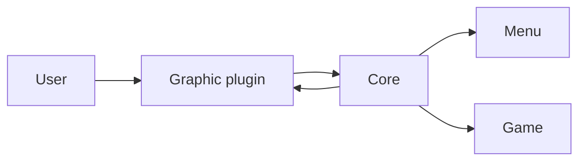
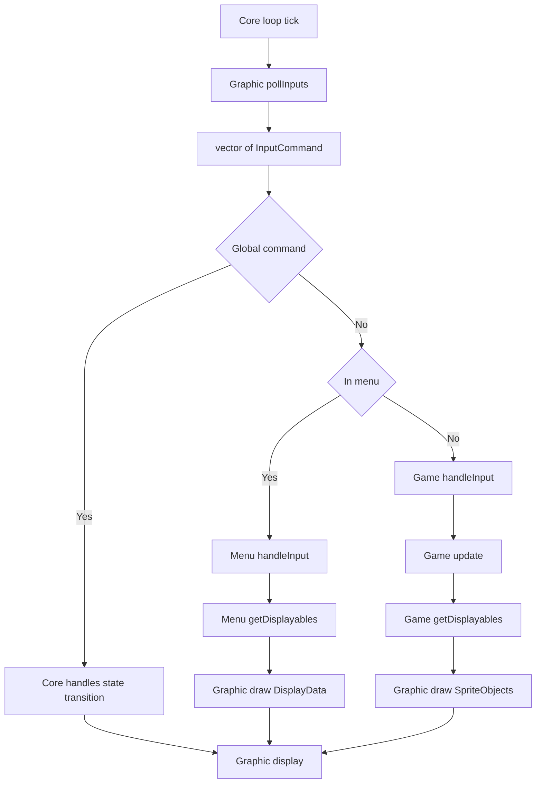
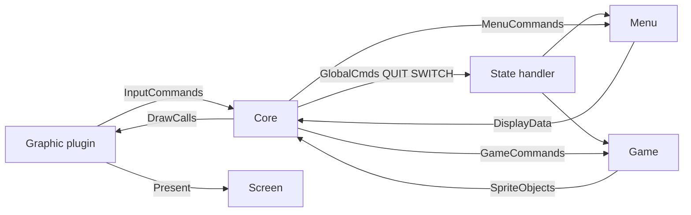
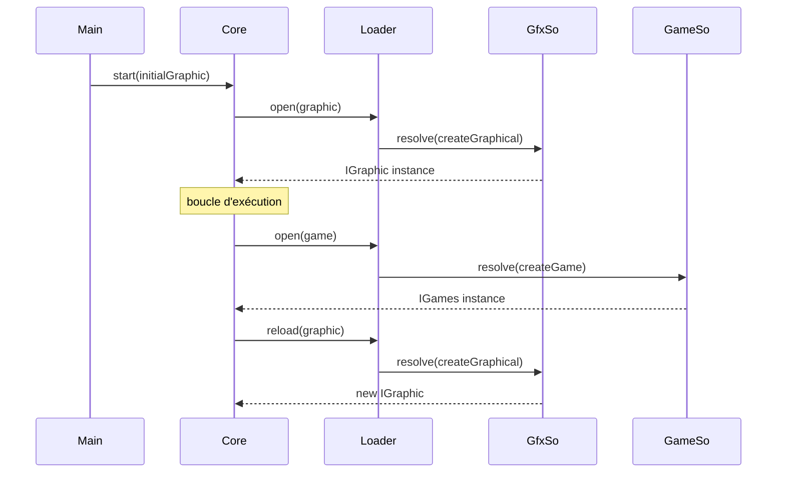

 # ARCADE-1 Architecture Schema

 Ce document présente un schéma simplifié et compatible Mermaid v8.8.0 décrivant les composants et les flux principaux.

 ## 1. Vue globale (simplifiée)

 ## 2. Rôles principaux

 - `main.cpp`: vérifie les arguments et instancie `Core` avec la bibliothèque graphique de départ.
 - `Core`: boucle principale, chargement dynamique des plugins, routage des commandes vers `Menu` ou `Game` et ordonnancement des appels de rendu.
 - `Menu`: découverte des plugins, gestion de la sélection, construction d'une `DisplayData` pour le rendu.
 - `IGraphic` et ses implémentations: lecture des entrées natives, conversion en `InputCommand`, dessin des objets et présentation à l'écran.
 - `IGames` et ses implémentations: logique du jeu, traitement des commandes, exposition des objets à dessiner.
 - `arcade_types.hpp`: contrat de types partagés (évite le couplage direct entre jeux et interface graphique).

 ## 3. Cycle d'une frame (simplifié)

 ## 4. Direction des données (entrée → logique → rendu)

 ## 5. Chargement dynamique (séquence simplifiée)

 ## 6. Résumé

 - `Core` est le médiateur central du runtime.
 - Les plugins sont indépendants et ne se connaissent pas directement.
 - Les types partagés sont centralisés dans `arcade_types.hpp` pour éviter le couplage strict entre jeux et interface graphique.

